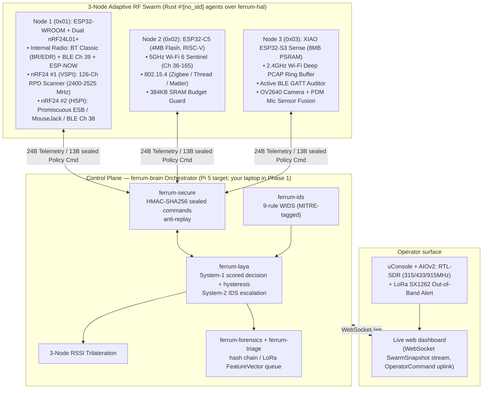
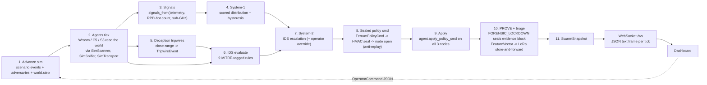

# Ferret (`Ferrum CyberSwarm`) — Architecture & Hardware Guide

Ferret is built as **two worlds around one boundary**. The `#![no_std]` cores (node agents, the Laya decision engine, the four pillars) are written once. In Phase 1 they run against a seeded RF simulator on a laptop; in Phase 2 the same crates are flashed onto ESP32 boards with real `esp-hal` drivers. The boundary between them is the [`ferrum-hal`](./crates/ferrum-hal/src/lib.rs) trait set.

## 1. Fleet Topology



In **Phase 1** the three nodes are agents running in-process against simulated PHYs (the ESP-NOW link is the `SimTransport`), and the uConsole sub-GHz view is a burst reported by the simulator. In **Phase 2** the arrows to the nodes become ESP-NOW radio links and the nodes run on silicon.

---

## 2. The HAL boundary (sim/firmware seam)

[`ferrum-hal`](./crates/ferrum-hal/src/lib.rs) is `#![no_std]`, allocation-free, and depends only on `ferrum-proto`. It defines what a node needs from its hardware:

| Trait | What it models | Phase 1 impl (`ferrum-sim`) | Phase 2 impl |
| :--- | :--- | :--- | :--- |
| `SpectrumScanner` | tune a channel, read the nRF24 `RPD` bit, sample RSSI | `SimScanner` over the shared `RfWorld` | `esp-hal` SPI nRF24 / Wi-Fi radio drivers |
| `PacketSniffer` | promiscuous frame source (`ESB`, `BLE`, `802.11` mgmt / deauth / `EAPOL`) with `FrameMeta` | `SimSniffer` | `esp-hal` promiscuous-mode capture |
| `Transport` | datagram `send` / `recv`, returns `Result` | `SimTransport` (infallible) | ESP-NOW |
| `Clock` | monotonic milliseconds | `SimClock` (simulated time) | hardware timer |

`NodeStatus` is the result of an agent tick: `Online(NodeTelemetry)` or `Offline`. The three agents (`WroomAgent`, `C5Agent`, `S3Agent`) are generic over the four traits, and each degrades to `Offline` if its transport errors, so a dead radio is a first-class state rather than a panic. `ferrum-hal` also ships heapless mock PHYs behind its `mock` feature for unit tests.

The rule that keeps the seam honest: **no `no_std` crate depends on `std`, the simulator, or the web stack.** `ferrum-sim` and `ferrum-brain` depend on the cores, never the reverse.

---

## 3. The explainable decision engine (`ferrum-laya`)

The old control plane was a priority `if/else` ladder. It is replaced by a scored model that says *how sure it is* and *why*. All math is integer; the System-1 core is `#![no_std]` with no allocation.

**System-1 (always available, bare-metal buildable):**

1. **Signals.** `signals_from(...)` maps the three nodes' telemetry, the count of RPD-hot nRF channels and any sub-GHz burst into six normalized `0..=100` signals: `jam_ratio`, `proximity`, `ghost_esb`, `deauth_eapol`, `bt_ble`, `subghz`.
2. **Scoring.** A transparent weight table (`WEIGHTS[policy][signal]`, plus a quiet-baseline bias that favours `WIDE_RECON`) scores six policies: `WIDE_RECON`, `ANOMALY_TRIAGE`, `SURGICAL_CAPTURE`, `FLOOD_JAM_SURVIVAL`, `TRIANGULATE_LOCK`, `SENTINEL_CORRELATE`. Scores are squared and given a small uncertainty floor, so no policy has zero raw mass before rounding. The percentages are then largest-remainder rounded so the distribution **sums to exactly 100**; an individual reported entry can still read 0% or 100%. Weight magnitudes preserve the retired ladder's priority (jam beats proximity / sub-GHz beats ghost-band beats deauth beats BLE), so the same policy wins as before, but the runner-ups are now visible.
3. **Hysteresis.** Re-tasking three radios is expensive, so the engine holds an incumbent policy and only replaces it when a challenger leads by at least **20 percentage points** in one tick, or leads for **3 consecutive ticks**. The first tick adopts the argmax directly.
4. **Rationale.** The `TypedDecision` carries the selected policy, the nRF mode, confidence, the full six-way distribution and the top three contributing signals with their share of the weighted score. That is what the dashboard's decision card renders.

**System-2 (feature `ids`, default on):** `LayaEngine::system2` lets IDS detections escalate the System-1 result. A `Critical` detection forces `FORENSIC_LOCKDOWN` (and arms the S3 camera and mic); a `High` detection adopts the rule's recommended policy; lower severities leave System-1 alone. System-2 pulls in `ferrum-ids`, which is `std`, hence the feature gate. CI builds `ferrum-laya` with `--no-default-features` on the host and for `riscv32imac-unknown-none-elf`.

`decision_latency_ms` is deliberately absent from the engine; latency is a presentation concern of the caller.

---

## 4. The simulator (`ferrum-sim`)

`ferrum-sim` is the Phase 1 stand-in for the physical world. It is `std` and fully deterministic for a given `(seed, scenario, tick sequence)`; a golden test pins the flagship run.

- **`RfWorld`** holds emitters, a seeded `Pcg64`, simulated time and per-node readouts. Emitter kinds: `WifiAp`, `BleAdv`, `Esb`, `Deauth`, `Eapol`, `Carrier`, `Jammer`. Each node sits at a fixed anchor (WROOM `(0,0)`, C5 `(6,0)`, S3 `(3,5.2)` metres) and tunes in its own channel numbering; a scanner hears an emitter when their occupied bandwidths overlap.
- **Physics.** Log-distance path loss, `RSSI = tx_dbm - 10 n log10(d)` with `n = 2.2`, bounded jitter around a `-97 dBm` noise floor, `RPD` asserting above `-64 dBm` (nRF24L01+ spec), and an inverse-distance trilateration helper for the radar.
- **Adversary models** (`Adversary`), each a scripted attacker that spawns and updates emitters from the world's seeded RNG:

| Adversary (`name()`) | What it does |
| :--- | :--- |
| `jammer` | Wideband (80 MHz) Layer-1 jammer; pegs RPD across more than 40 nRF channels |
| `evil-twin-deauth` | 5 GHz evil-twin AP plus a deauth flood (about 12 frames per 100 ms tick at the C5) for the first few seconds; enough to flip System-1 to `SURGICAL_CAPTURE`, well under the IDS deauth-flood rule |
| `mousejack-esb` | Hopping ESB keystroke injector, optionally with a ghost-band carrier implant |
| `ble-rotating-implant` | BLE advertiser that rotates its private MAC; the emitter id is the identity that persists |
| `subghz-replay` | 433 MHz replay bursts; no 2.4/5 GHz emitter, surfaced to the operator deck as a sub-GHz burst |
| `bt-skimmer` | Strong, chatty BLE advertiser right next to a sensor (close-range intruder) |

- **Scenarios.** A `Scenario` is a time-ordered list of `Spawn` / `Clear` events; `ScenarioDriver` plays it against a borrowed world, and `SimController` wraps driver plus owned world for tests. Operator-injected adversaries get ids after the scenario's, so they never collide. Built-in scenarios: `quiet` (empty) and `red-team-incursion` (the flagship, see [`docs/DEMO.md`](./docs/DEMO.md)).

---

## 5. Live per-tick data flow

One `Orchestrator::tick()` in `ferrum-brain` runs the entire pipeline. The dashboard is a pure consumer of its output.



In order:

1. **Advance the sim.** Due scenario events fire, active adversaries update their emitters, the world steps by `1000 / tick_hz` ms.
2. **Agents tick.** Each node agent reads the stepped world through its PHYs and returns `NodeStatus`. (A node that goes offline is replaced by a quiet telemetry stand-in so the math stays total, and its card shows `OFFLINE`.)
3. **Signals.** Telemetry, the WROOM's RPD-hot channel count and any sub-GHz burst become the six-signal vector.
4. **System-1** scores the six policies and applies hysteresis.
5. **Deception.** A close-range intruder (a `bt-skimmer`, or anomaly RSSI above `-42 dBm`) trips the BLE canary decoy and emits a `TripwireEvent`.
6. **IDS.** The nine WIDS rules evaluate telemetry plus tripwires and emit MITRE ATT&CK-tagged `Detection`s.
7. **System-2** escalates on detections; an operator `ForcePolicy` override is applied last.
8. **Sealed command.** The decision becomes a 13B `FerrumPolicyCmd`, HMAC-SHA256 sealed by the brain's `SecureChannel` and opened by the node-side channel. Replay and bad-MAC frames are counted and logged as alert events, never panics.
9. **Apply.** The verified command is applied to all three agents (policy, nRF mode, PSRAM partition, camera / mic power, CPU frequency).
10. **PROVE and triage.** On `FORENSIC_LOCKDOWN` a PCAP block is sealed into the SHA-256 `HashChain`. Every tick a 12-byte `FeatureVector` is queued for the LoRa uplink; when more than 40 nRF channels are RPD-hot the 2.4 GHz link is treated as contended and the queue is held instead of flushed.
11. **Snapshot.** Everything is assembled into a `SwarmSnapshot`.

**Transport.** The server is axum. The `Orchestrator` owns `Rc<RefCell<RfWorld>>` handles, so it is `!Send`; one dedicated `ferrum-tick` thread constructs and owns it, publishing each snapshot on a `tokio::sync::watch` channel (a slow client always sees the latest frame, never a backlog). Each WebSocket client forwards snapshots out and parses inbound text frames as `OperatorCommand`s over an `mpsc` channel back to the tick thread. `GET /` serves the dashboard HTML, embedded at compile time.

**Operator commands** (externally-tagged JSON): `{"InjectAdversary":"jammer"}`, `{"ClearAdversary":3}`, `{"ForcePolicy":9}` (`0` releases the override), `{"SetScenario":"quiet"}`, `"Pause"`, `"Resume"`, `{"SetTickHz":4}`. Snapshot field names are a contract with the dashboard (stable `snake_case`; policies serialize as strings like `"FORENSIC_LOCKDOWN"`).

---

## 6. Adaptive Ferrum Policy Table

> **Backing today:** in Phase 1 this table is **sim-backed**. The agents track the policy, nRF mode, PSRAM quota and camera / mic power state and report them in telemetry, and the simulated radios respond, but no physical radio, SPI bus or camera is driven. In **Phase 2 it becomes firmware-backed**: each cell below is realised by `esp-hal` peripheral drivers behind the `ferrum-hal` traits, with no change to the decision logic that selects the row.

| Policy Mode | ID | ESP32-WROOM (+ 2× nRF24L01+) | ESP32-C5 (4MB Flash, 5GHz) | XIAO ESP32-S3 Sense (8MB PSRAM) |
| :--- | :--- | :--- | :--- | :--- |
| **`WIDE_RECON`** | `0x01` | `SPLIT_SPECTRUM_WATERFALL`: `nRF#1` sweeps `2400-2462MHz`, `nRF#2` sweeps `2463-2525MHz` (Ghost Band); internal radio does passive BT Classic + BLE | Sweeps 5GHz UNII-1/2/3 + 2.4GHz + Zigbee @ 80MHz; 96KB SRAM ring | 7.1MB PSRAM allocated to 2.4GHz PCAP ring; Camera & PDM Mic powered OFF |
| **`ANOMALY_TRIAGE`** | `0x02` | `SIMULTANEOUS_3CH_BLE`: Locks `nRF#1` on BLE Ch 37, `nRF#2` on BLE Ch 38, Internal on BLE Ch 39 + BT Classic inquiry | Offloads 2.4GHz to S3; dedicates 100% dwell time to 5GHz channels | Reallocates 1.5MB PSRAM to Active BLE GATT Service/Characteristic enumeration |
| **`SURGICAL_CAPTURE`** | `0x03` | Continuous 3-channel BLE + ESP-NOW high-priority relay | Pins to target 5GHz channel @ 240MHz; expands SRAM ring buffer to 220KB | Expands zero-drop PCAP ring buffer to 7.5MB PSRAM |
| **`FLOOD_JAM_SURVIVAL`** | `0x04` | `LAYER1_JAM_TRIAGE`: Maps `RPD > -64dBm` carrier energy across all 126 channels to locate jammer center frequency | Fails over swarm monitoring to unjammed 5GHz band (`Ch 36..165`) | Enables hardware MAC/DMA frame deduplication filter |
| **`TRIANGULATE_LOCK`** | `0x05` | `HUNTER_KILLER_ESB`: `nRF#1` spots Ghost-Band/GFSK burst, locks `nRF#2` into Promiscuous ESB (`0xAA55` preamble) + Anchor A RSSI | Synchronizes as Anchor B RSSI sampler | Synchronizes as Anchor C RSSI sampler |
| **`SENTINEL_CORRELATE`** | `0x06` | Tracks target BLE structural hash across MAC rotations | Locks 5GHz + 2.4GHz proximity RSSI | Shrinks PCAP ring to 4MB; allocates 2.5MB PSRAM to `OV2640` JPEG + 512KB to `PDM` Mic FFT |

The six rows above are the policies **System-1 scores**. Four more wire-protocol states exist (`PolicyMode` `0x07..=0x0A`) and are reached through System-2 escalation or an operator override rather than System-1 scoring: `IDS_ENFORCE` (`0x07`), `HONEYPOT_LURE` (`0x08`), `FORENSIC_LOCKDOWN` (`0x09`, seals the evidence chain and arms camera / mic) and `MESH_SURVIVE` (`0x0A`, LoRa `FeatureVector` store-and-forward).

> **Jammer outcome:** a confirmed Layer-1 jammer trips IDS rule `FR-JAM-001` at `High` severity with `recommended_policy = FLOOD_JAM_SURVIVAL`, so System-2 adopts `FLOOD_JAM_SURVIVAL` (the row above) as the live policy for as long as the jam lasts. It does **not** force `FORENSIC_LOCKDOWN` (`0x09`): that is reached by a `Critical` detection, e.g. an `FR-HP-001` honeypot decoy trip, which freezes the PCAP ring, seals the evidence block and arms the camera / mic. (If a jam and a decoy trip coincide, the `Critical` wins and the swarm locks down.) The sim's scenario jammer is deliberately tuned to stay in the -62..-46 dBm window at the sensors: strong enough to peg more than 40 RPD channels, but below the -42 dBm close-range threshold so it does not also trip the proximity honeypot, and centred low enough (nRF ch 45) to stay out of the 2485-2525 MHz ghost band so it does not raise `FR-GHOST-001`.

---

## 7. Directory Structure

```text
ferret/
├── Cargo.toml                         # Rust workspace manifest (13 crates)
├── rust-toolchain.toml                # stable + rustfmt + clippy
├── justfile                           # test / lint / run / demo
├── README.md                          # Intro, quickstart, crate table
├── ARCHITECTURE.md                    # This document
├── dashboard/
│   └── ferrum_cyberswarm_deck.html    # Live tactical dashboard (embedded into ferrum-brain)
├── docs/
│   ├── DEMO.md                        # 60-second scripted walkthrough
│   ├── media/                         # Dashboard screenshot
│   └── superpowers/                   # Phase 1 design spec + implementation plan
└── crates/
    ├── ferrum-proto/                  # #![no_std] 24B Telemetry & 13B Policy wire protocol + CRC8
    ├── ferrum-hal/                    # #![no_std] SpectrumScanner / PacketSniffer / Transport / Clock + mock PHYs
    ├── ferrum-laya/                   # #![no_std] scored decision engine + hysteresis (System-2 behind `ids`)
    ├── ferrum-wroom-nrf/              # #![no_std] WROOM agent: dual-nRF24, ESB sniffer, BLE de-anonymizer
    ├── ferrum-c5-scout/               # #![no_std] C5 agent: 5GHz Wi-Fi 6 + 802.15.4 scout
    ├── ferrum-s3-sense/               # #![no_std] S3 agent: 8MB PSRAM partitioner + Cam/Mic trigger
    ├── ferrum-ids/                    # std: 9-rule WIDS engine (Pillar 1, DETECT)
    ├── ferrum-deceive/                # #![no_std] decoy AP / BLE beacons / tripwires (Pillar 2, DECEIVE)
    ├── ferrum-secure/                 # #![no_std] SHA-256 / HMAC / anti-replay channel (Pillar 3, DEFEND)
    ├── ferrum-forensics/              # #![no_std] hash chain + store-and-forward (Pillar 4, PROVE)
    ├── ferrum-triage/                 # #![no_std] histograms / entropy / LoRa FeatureVector
    ├── ferrum-sim/                    # std: seeded RfWorld, physics, adversaries, scenarios, sim PHYs
    └── ferrum-brain/                  # std: Orchestrator, axum + WebSocket server, --headless narrative
```
