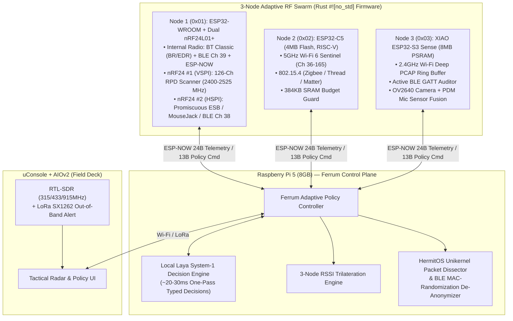

# Ferret (`Ferrum CyberSwarm`) — Architecture & Hardware Guide

## 1. Fleet Topology



---

## 2. Adaptive Ferrum Policy Table

| Policy Mode | ID | ESP32-WROOM (+ 2× nRF24L01+) | ESP32-C5 (4MB Flash, 5GHz) | XIAO ESP32-S3 Sense (8MB PSRAM) |
| :--- | :--- | :--- | :--- | :--- |
| **`WIDE_RECON`** | `0x01` | `SPLIT_SPECTRUM_WATERFALL`: `nRF#1` sweeps `2400-2462MHz`, `nRF#2` sweeps `2463-2525MHz` (Ghost Band); internal radio does passive BT Classic + BLE | Sweeps 5GHz UNII-1/2/3 + 2.4GHz + Zigbee @ 80MHz; 96KB SRAM ring | 7.1MB PSRAM allocated to 2.4GHz PCAP ring; Camera & PDM Mic powered OFF |
| **`ANOMALY_TRIAGE`** | `0x02` | `SIMULTANEOUS_3CH_BLE`: Locks `nRF#1` on BLE Ch 37, `nRF#2` on BLE Ch 38, Internal on BLE Ch 39 + BT Classic inquiry | Offloads 2.4GHz to S3; dedicates 100% dwell time to 5GHz channels | Reallocates 1.5MB PSRAM to Active BLE GATT Service/Characteristic enumeration |
| **`SURGICAL_CAPTURE`** | `0x03` | Continuous 3-channel BLE + ESP-NOW high-priority relay | Pins to target 5GHz channel @ 240MHz; expands SRAM ring buffer to 220KB | Expands zero-drop PCAP ring buffer to 7.5MB PSRAM |
| **`FLOOD_JAM_SURVIVAL`** | `0x04` | `LAYER1_JAM_TRIAGE`: Maps `RPD > -64dBm` carrier energy across all 126 channels to locate jammer center frequency | Fails over swarm monitoring to unjammed 5GHz band (`Ch 36..165`) | Enables hardware MAC/DMA frame deduplication filter |
| **`TRIANGULATE_LOCK`** | `0x05` | `HUNTER_KILLER_ESB`: `nRF#1` spots Ghost-Band/GFSK burst, locks `nRF#2` into Promiscuous ESB (`0xAA55` preamble) + Anchor A RSSI | Synchronizes as Anchor B RSSI sampler | Synchronizes as Anchor C RSSI sampler |
| **`SENTINEL_CORRELATE`** | `0x06` | Tracks target BLE structural hash across MAC rotations | Locks 5GHz + 2.4GHz proximity RSSI | Shrinks PCAP ring to 4MB; allocates 2.5MB PSRAM to `OV2640` JPEG + 512KB to `PDM` Mic FFT |

---

## 3. Directory Structure (`/Users/tanujyerremsetty/Downloads/ferret`)

```text
ferret/
├── Cargo.toml                         # Rust Workspace manifest
├── README.md                          # Quickstart & pinout reference
├── ARCHITECTURE.md                    # Full system architecture & policy spec
├── dashboard/
│   └── ferrum_cyberswarm_deck.html    # Standalone interactive Tactical Control Deck
└── crates/
    ├── ferrum-proto/                  # #![no_std] 24B Telemetry & 13B Policy wire protocol + CRC8
    ├── ferrum-wroom-nrf/              # #![no_std] Dual-nRF24 SPI driver, ESB sniffer & BLE de-anonymizer
    ├── ferrum-c5-scout/               # #![no_std] ESP32-C5 5GHz Wi-Fi 6 + 802.15.4 scout state machine
    ├── ferrum-s3-sense/               # #![no_std] XIAO S3 Sense 8MB PSRAM partitioner + Cam/Mic trigger
    └── ferrum-brain/                  # Raspberry Pi 5 Ferrum + Laya System-1 engine & 3-node radar
```
