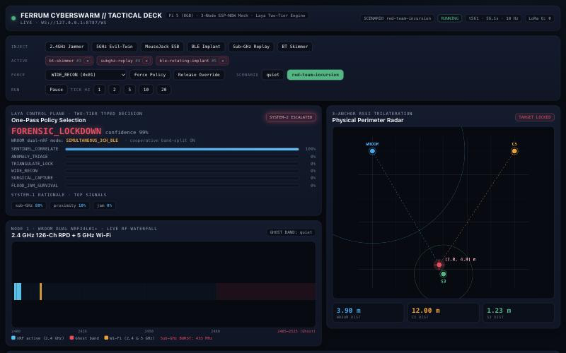
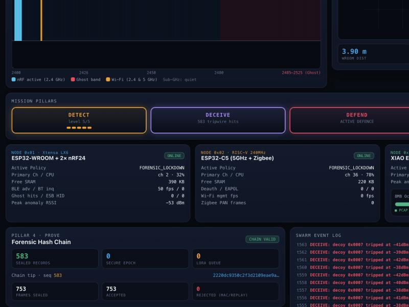

<div align="center">

# Ferret

**Three radios, one brain, and an evidence trail that notices if anyone edits it.**

*A wireless-defence swarm in Rust. It runs on your laptop today; the firmware comes next.*



</div>

---

Wireless attacks are quiet. A jammer just looks like bad Wi-Fi. An evil twin looks like
the café network. A cheap 2.4 GHz dongle can push keystrokes into a wireless keyboard
receiver, and nothing on the desk blinks. By the time someone notices, the attacker has
left and the only evidence is a hunch.

**Ferret watches the air so you don't have to.** Three sensor nodes listen across
2.4 GHz, 5 GHz, BLE and 802.15.4. A control plane (the *brain*) scores what they hear,
picks one policy for the whole swarm, tells you *why* it picked it, and re-tasks the
radios. Its commands are signed and replay-proof. Every piece of evidence is sealed into a
SHA-256 hash chain, so a record that was altered after the fact fails verification.

The whole thing is deterministic: same seed, same scenario, same run, down to the byte.

## Status, honestly

| | State |
| :--- | :--- |
| **Phase 1: the living simulation** | **Done.** Swarm, decision engine, four pillars, live dashboard, all running against a seeded RF simulator. |
| **Phase 2: real hardware** | **Not started.** No `esp-hal` drivers, no ESP-NOW link to a Raspberry Pi 5, no firmware binaries yet. |

What that means in practice: the radios, the six attackers and the reference hardware
described below are **modelled in software**. No physical radio, SPI bus, camera or
microphone is driven by anything in this repository. What *is* real is the code that will
run on the boards: the node agents and decision engine are `#![no_std]`, and CI
cross-compiles them for bare-metal RISC-V (`riscv32imac-unknown-none-elf`) on every push.

The last CI run on `main` (commit `33b7744`) passed fmt, clippy with `-D warnings`, and
**101 tests**, plus the bare-metal builds.

## Sixty seconds to a live swarm

You need Rust (the repo pins `stable` with `rustfmt` and `clippy` in
[`rust-toolchain.toml`](./rust-toolchain.toml); rustup picks it up automatically). If
`cargo --version` doesn't work yet:

```bash
curl --proto '=https' --tlsv1.2 -sSf https://sh.rustup.rs | sh
```

Then, from the repository root:

```bash
cargo run -p ferrum-brain
```

Open **<http://127.0.0.1:8787/>**. You're watching the `red-team-incursion` scenario,
seed `42`, at 10 ticks a second: attackers arrive, the swarm notices, argues with itself
in public, and locks down. A guided 60-second tour is in [`docs/DEMO.md`](./docs/DEMO.md).

Prefer a terminal? Same run, narrated, no browser and no server:

```bash
cargo run -p ferrum-brain -- --headless
```

And the tests:

```bash
cargo test --workspace
```

### `ferrum-brain` flags

| Flag | Default | Meaning |
| :--- | :--- | :--- |
| `--scenario <name>` | `red-team-incursion` | Scenario timeline to play: `red-team-incursion` or `quiet` |
| `--seed <n>` | `42` | RF-world seed. Same seed + scenario = same run, every time |
| `--port <n>` | `8787` | Dashboard / WebSocket port (binds `127.0.0.1` only) |
| `--tick-hz <n>` | `10` | Initial tick rate. The flagship timeline is authored at 10 Hz |
| `--headless` | off | Print the tactical narrative instead of starting the server |
| `--ticks <n>` | scenario length + a short tail | Number of ticks for `--headless` |

There's also a [`justfile`](./justfile): `just test`, `just lint` (clippy `-D warnings` +
`fmt --check`), `just run`, `just demo`.

## The four pillars

Ferret is organised around four jobs. Each one is its own crate.

- **`DETECT`** (`ferrum-ids`): a 9-rule wireless IDS with MITRE ATT&CK tags and a
  severity ladder. A `Critical` hit escalates the whole swarm.
- **`DECEIVE`** (`ferrum-deceive`): honeypots and canaries. A fake access point with no
  backend (DHCP, DNS and upstream are sink-holed), plus decoy BLE beacons and a canary GATT
  service. No legitimate device has any reason to touch them, so any probe, association or
  read is a tripwire.
- **`DEFEND`** (`ferrum-secure`): the brain's commands to the nodes travel over an
  HMAC-SHA256 channel with a strictly monotonic anti-replay counter and epoch key rotation.
  A replayed or tampered command is rejected. SHA-256 and HMAC are implemented from FIPS
  180-4 and RFC 2104 in `no_std` Rust.
- **`PROVE`** (`ferrum-forensics`): evidence blocks are sealed into a SHA-256 hash chain
  with `verify_chain`, plus a bounded store-and-forward queue.

## How the brain decides

The decision engine is called **Laya**, and it has two tiers.

**System-1** is fast and transparent. Six normalised signals go through an integer weight
table; the six candidate policies get a score distribution that sums to exactly 100; the
top three signals are reported as the rationale. Hysteresis (a 20-point margin or a
3-tick dwell) stops the swarm flapping between policies.

**System-2** is the IDS looking over its shoulder. A `High` detection adopts the rule's
recommended policy; a `Critical` one forces `FORENSIC_LOCKDOWN` regardless of what
System-1 thought.

> **Reading the jammer run:** a confirmed Layer-1 jammer trips IDS rule `FR-JAM-001` at
> `High`, which agrees with System-1's own pick (and would be adopted by System-2 if it did
> not): the dashboard reads `FLOOD_JAM_SURVIVAL` for the whole jam, with no escalation
> marker. A jammer is survivable — the swarm answers it by re-tasking, failing over to
> 5 GHz and de-duplicating frames, not by locking down. `FORENSIC_LOCKDOWN` is reserved for
> a `Critical` detection such as a honeypot decoy trip, which freezes the PCAP ring, seals
> the evidence block and arms the S3 node's camera / mic (see the note under *Reference
> hardware*). In the flagship scenario you see both: the jam phase shows
> `FLOOD_JAM_SURVIVAL`, then the close-range intruder trips the decoy and the swarm locks
> down.

## What you're looking at

The dashboard is a single page served by `ferrum-brain` itself, fed by a WebSocket
(`/ws`) carrying one `SwarmSnapshot` JSON frame per tick.

- **Spectrum waterfall:** the WROOM node's 126-channel nRF24 RPD sweep (2400-2525 MHz,
  including the 2485-2525 MHz "ghost band" above standard Wi-Fi), plus the Wi-Fi channels
  the C5 and S3 are tuned to and any sub-GHz burst the operator deck hears.
- **Trilateration radar:** the three nodes are anchors; the target is placed from their
  peak-anomaly RSSI readings.
- **Laya decision feed:** the selected policy, a confidence figure, the full six-policy
  score distribution, the top three signals behind it, and a marker when System-2
  overrides System-1.
- **The four pillars:** IDS rules firing, decoy tripwires, command-channel counters, and
  the forensic chain.
- **Three node cards:** policy, channel, load and free memory per node, including the S3's
  8 MB PSRAM partition and camera / mic power state.
- **Forensic hash chain:** sealed SHA-256 evidence records, with chain verification.
- **IDS detections and event log:** what fired this tick (with MITRE ATT&CK tags), plus a
  running log of operator actions and security events.
- **Operator controls:** inject any of six simulated adversaries, force or release a
  policy, switch scenario, pause / resume, and set the tick rate (1 / 2 / 5 / 10 / 20 Hz).

The six simulated adversaries are `jammer`, `evil-twin-deauth`, `mousejack-esb`,
`ble-rotating-implant`, `subghz-replay` and `bt-skimmer`.



## Same seed, same run

`ferrum-sim` is fully deterministic for a given seed, scenario and tick sequence. A golden
test (`crates/ferrum-sim/tests/golden.rs`) hashes 300 ticks of the flagship scenario,
every probed RSSI and every sniffed frame, and pins the result to a fixed value. If the
simulation drifts by one bit, the test fails.

One caveat, stated in the test itself: the hash folds in floating-point maths, so it is
pinned per toolchain and target, not as a cross-platform constant.

## Two worlds, one seam

| | World 1: Simulation (works today) | World 2: Firmware (Phase 2) |
| :--- | :--- | :--- |
| Radios | Seeded RF world with path-loss physics and scripted adversaries (`ferrum-sim`) | Real `esp-hal` drivers: nRF24L01+, Wi-Fi 6, BLE, 802.15.4 |
| Node logic | `WroomAgent` / `C5Agent` / `S3Agent` | The same agent code |
| Decision engine | `ferrum-laya` | The same crate |
| Control plane | `ferrum-brain` on your laptop, streaming a live web dashboard | `ferrum-brain` on a Raspberry Pi 5 |

The seam is [`ferrum-hal`](./crates/ferrum-hal/src/lib.rs): a handful of `#![no_std]`
traits (`SpectrumScanner`, `PacketSniffer`, `Transport`, `Clock`). Node agents are
generic over them, so moving from the simulator to silicon means writing new trait
*implementations*, not new logic. HAL transports already return `Result`, and every agent
degrades to `Offline` on a transport error: something that never happens in the sim and
will happen constantly on a real radio.

## Workspace architecture (13 crates)

| Crate | Target | Pillar / Role |
| :--- | :--- | :--- |
| [`crates/ferrum-proto`](./crates/ferrum-proto/src/lib.rs) | `#![no_std]` | 24B `NodeTelemetry` and 13B `FerrumPolicyCmd` wire protocol, CRC-8, 126-channel nRF24 `RPD` bitmap, 10 `PolicyMode` states (`0x01..=0x0A`) |
| [`crates/ferrum-hal`](./crates/ferrum-hal/src/lib.rs) | `#![no_std]` | **The sim/firmware boundary:** `SpectrumScanner`, `PacketSniffer`, `Transport` and `Clock` traits, `NodeStatus`, plus heapless mock PHYs behind the `mock` feature |
| [`crates/ferrum-laya`](./crates/ferrum-laya/src/lib.rs) | `#![no_std]` core | **Decision engine:** six normalised signals, a transparent integer weight table scored into a distribution that sums to exactly 100, hysteresis against flapping. System-2 IDS escalation sits behind the default-on `ids` feature, so the System-1 core builds bare-metal with `--no-default-features` |
| [`crates/ferrum-wroom-nrf`](./crates/ferrum-wroom-nrf/src/lib.rs) | `#![no_std]` | **Node 1 agent** (ESP32-WROOM + dual nRF24L01+): split-spectrum waterfall, ghost-band watcher, ESB / MouseJack injection detection, a BLE structural fingerprint that follows a device across MAC rotations. Degrades to `Offline` on transport error |
| [`crates/ferrum-c5-scout`](./crates/ferrum-c5-scout/src/lib.rs) | `#![no_std]` | **Node 2 agent** (ESP32-C5, RISC-V): 5 GHz UNII-1/2/3 channel scheduler, 802.15.4 reporting, 384 KB SRAM budget guard, 5 GHz failover survival mode |
| [`crates/ferrum-s3-sense`](./crates/ferrum-s3-sense/src/lib.rs) | `#![no_std]` | **Node 3 agent** (XIAO ESP32-S3 Sense): dynamic 8 MB PSRAM partitioning between a PCAP ring, a BLE GATT cache and an `OV2640` camera + `PDM` mic buffer |
| [`crates/ferrum-ids`](./crates/ferrum-ids/src/lib.rs) | `std` | **`DETECT`:** 9-rule WIDS engine with MITRE ATT&CK tags, severity ladder, and the System-2 escalation rule |
| [`crates/ferrum-deceive`](./crates/ferrum-deceive/src/lib.rs) | `#![no_std]` | **`DECEIVE`:** sink-holed `FakeSoftAp` 802.11 beacon builder, iBeacon / Eddystone-UID / canary GATT decoys, 24B `TripwireEvent` |
| [`crates/ferrum-secure`](./crates/ferrum-secure/src/lib.rs) | `#![no_std]` | **`DEFEND`:** FIPS 180-4 SHA-256, RFC 2104 HMAC-SHA256, anti-replay `SecureChannel`, epoch key rotation |
| [`crates/ferrum-forensics`](./crates/ferrum-forensics/src/lib.rs) | `#![no_std]` | **`PROVE`:** SHA-256 hash-chained evidence sealing (`HashChain`, `verify_chain`) and a bounded `StoreForwardQueue` |
| [`crates/ferrum-triage`](./crates/ferrum-triage/src/lib.rs) | `#![no_std]` | **Survival / triage:** 16-bin `RssiHistogram`, sliding `RateWindow`, Shannon channel entropy, 12-byte compressed `FeatureVector` for a LoRa `SX1262` uplink |
| [`crates/ferrum-sim`](./crates/ferrum-sim/src/lib.rs) | `std` | **The simulated world:** seeded `RfWorld`, log-distance path loss and trilateration, six adversary models, named scenario timelines, `SimController`, and the sim implementations of the `ferrum-hal` traits. Home of the golden test |
| [`crates/ferrum-brain`](./crates/ferrum-brain/src/main.rs) | `std` | Library + binary. The `Orchestrator` composes the per-tick pipeline; an axum server streams `SwarmSnapshot` JSON over WebSocket and accepts `OperatorCommand`s; `--headless` prints the narrative |

`ferrum-ids`, `ferrum-sim` and `ferrum-brain` are the host side (`std`). The other ten are
`#![no_std]`, written to compile into both the simulator and the firmware, and CI
cross-builds all ten for `riscv32imac-unknown-none-elf`.

The full design, per-tick data flow and policy table are in
[`ARCHITECTURE.md`](./ARCHITECTURE.md).

## The reference hardware (modelled, not built)

This is the kit Ferret is designed for. In Phase 1 every item is played by software: the
three nodes are the agents above running against simulated PHYs, and the Pi and uConsole
roles are played by `ferrum-brain` on your machine.

- **Control plane:** Raspberry Pi 5 (8 GB) running the Laya System-1 / System-2 engine
- **Operator deck:** ClockworkPi uConsole with a HackerGadgets AIOv2 (`RTL-SDR` sub-GHz and `LoRa SX1262`)
- **Node 1 (`0x01`):** ESP32-WROOM + dual nRF24L01+ (126-channel 2400-2525 MHz scan, ESB / MouseJack detection, decoy SoftAP / BLE honeypot)
- **Node 2 (`0x02`):** ESP32-C5 (RISC-V), dual-band Wi-Fi 6 `Ch 36-165` plus `802.15.4`
- **Node 3 (`0x03`):** Seeed XIAO ESP32-S3 Sense (8 MB PSRAM): deep 2.4 GHz PCAP ring, BLE GATT auditor, `OV2640` camera and `PDM` mic

**About the camera and mic.** The S3 model keeps both powered off by default. The decision
engine switches them on in two policies: `SENTINEL_CORRELATE` (the policy for an anomalous
transmitter in close proximity) and `FORENSIC_LOCKDOWN` (a `Critical` IDS
detection). In Phase 1 this is a state flag in telemetry and on the dashboard; nothing is
recorded. There is no consent or operator-approval step in that path today.

## Phase 2: real hardware

Phase 2 replaces the simulated PHYs with `esp-hal` drivers and flashes the same agent and
decision crates onto the boards. The groundwork already in the tree:

- the node agents and `ferrum-laya` are `#![no_std]` and generic over `ferrum-hal`;
- CI builds the no_std crates for `riscv32imac-unknown-none-elf`, including the Laya
  System-1 core (`cargo build -p ferrum-laya --no-default-features --target riscv32imac-unknown-none-elf`);
- transports return `Result` and agents degrade to `Offline` on error.

**Not built yet:** the per-board `esp-hal` implementations of `SpectrumScanner` /
`PacketSniffer` / `Transport` / `Clock`, the ESP-NOW link to a Pi 5, and the firmware
binaries. Phase 2 gets its own spec; the Phase 1 design is in
[`docs/superpowers/specs/`](./docs/superpowers/specs/2026-10-29-ferret-living-swarm-design.md).

## Development

```bash
cargo fmt --check
cargo clippy --workspace -- -D warnings
cargo test --workspace
cargo build -p ferrum-laya --no-default-features --target riscv32imac-unknown-none-elf
```

That is what CI ([`.github/workflows/ci.yml`](./.github/workflows/ci.yml)) runs on every
push and pull request. The last step needs `rustup target add riscv32imac-unknown-none-elf`.

## Use it responsibly

Ferret is a defensive research platform. Phase 1 is a simulation and touches no real
radio. When hardware arrives, only monitor spectrum and networks you own or are authorised
to assess, and follow the radio and privacy laws where you operate.

## Licence

MIT, as declared in the workspace [`Cargo.toml`](./Cargo.toml).
